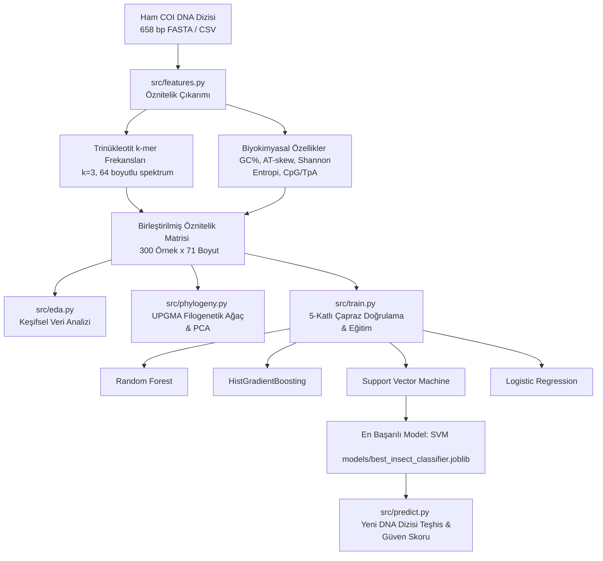

# 🧬🦗 Insect Phylogenetics & Taxonomic AI Classification (Midterm Project)

Biyolojide Yapay Zeka (*Artificial Intelligence in Biology*) dersi için hazırlanmış; **mitokondriyal DNA barkodlama (COI geni)** ve **hizalamasız k-mer öznitelik çıkarımı** ile böcek takımlarının filogenetik analizi ve yapay zeka ile taksonomik sınıflandırılması projesidir.

---

## 📌 Biyolojik Arka Plan & Problem Tanımı

### 1. DNA Barkodlama ve Mitokondriyal COI Geni
Geleneksel entomolojide tür teşhisi; morfolojik incelemeler, mikroskobik diseksiyon ve taksonomi uzmanlığı gerektirir. Ancak larva evreleri, hasar görmüş örnekler ve kriptik türlerde morfolojik ayrım yetersiz kalmaktadır.

Bu sorunu çözmek için Paul Hebert ve çalışma arkadaşları (2003) tarafından önerilen **DNA Barkodlama (*DNA Barcoding*)** sistemi geliştirilmiştir. Hayvanlar aleminde ve özellikle böceklerde evrensel barkod bölgesi olarak mitokondriyal **Sitokrom c Oksidaz Alt Birim I (*Cytochrome c Oxidase Subunit I - COI / cox1*)** geninin ~658 baz çiftlik (bp) **Folmer bölgesi** kullanılır:
- **Mitokondriyal DNA avantajı:** Hücre başına yüzlerce kopya, maternal kalıtım, intron içermemesi ve evrimsel mutasyon hızının taksonomik ayrıma uygunluğu.
- **Folmer Primerleri:** `LCO1490` ve `HCO2198` primerleri ile amplifiye edilir.

### 2. Hizalamasız (*Alignment-Free*) Filogenetik ve Yapay Zeka
Klasik moleküler filogenetik; çoklu dizi hizalamasına (*Multiple Sequence Alignment - MSA; ClustalW, MUSCLE*) ve yoğun hesaplama gerektiren Maximum Likelihood / Bayesian ağaçlarına dayanır. Dizilerin uzaması ve örnek sayısının artması durumunda $O(N^2)$ ve $O(N^3)$ karmaşıklık darboğaz yaratır.

Bu projede geliştirilen **Hizalamasız Yapay Zeka Pipeline'ı**:
1. DNA dizisini hizalama yapmadan **k-mer frekans vektörlerine ($k=3$, 64 kodon/trinükleotit spektrumu)** dönüştürür.
2. Biyofizikokimyasal göstergeleri (**GC%, AT-skew, GC-skew, Shannon dizi entropisi, CpG/TpA dinükleotit oranları**) entegre eder.
3. Hem denetimsiz filogenetik kümeleme (**UPGMA Dendrogramı & PCA**) hem de denetimli çok sınıflı makine öğrenmesi sınıflandırması gerçekleştirir.

---

## 🦋 Kapsanan Böcek Takımları (Insect Taxonomic Orders)

Projede böcekler sınıfının (Class: *Insecta*) en geniş ve ekolojik/tıbbi açıdan en kritik 6 takımı modellenmiştir:

| Takım (*Order*) | Türkçe Adı | Temsil Edilen Tür Örnekleri | Biyolojik & Ekolojik Rolü |
|---|---|---|---|
| **Coleoptera** | Kın kanatlılar | *Tribolium castaneum*, *Coccinella septempunctata*, *Harmonia axyridis* | Dünyanın en zengin hayvan takımı; tarım zararlıları ve biyolojik mücadele ajanları. |
| **Diptera** | İki kanatlılar / Sinekler | *Drosophila melanogaster*, *Aedes aegypti*, *Anopheles gambiae* | Model organizmalar; sıtma ve dang humması gibi hastalıkların vektörleri. |
| **Lepidoptera** | Pul kanatlılar (Kelebek & Güve) | *Bombyx mori*, *Danaus plexippus*, *Manduca sexta*, *Pieris rapae* | Tozlayıcılar (polinatörler), ipek üretimi ve bitki biyolojisi göstergeleri. |
| **Hymenoptera** | Zar kanatlılar (Arı & Karınca) | *Apis mellifera*, *Bombus terrestris*, *Formica rufa*, *Polistes dominula* | Ekosistemin temel tozlaştırıcıları, sosyal böcekler, aşırı yüksek A+T mitokondriyal genomu. |
| **Hemiptera** | Yarım kanatlılar (Bit & Tahtakurusu) | *Acyrthosiphon pisum*, *Halyomorpha halys*, *Cimex lectularius* | Delici-emici ağız yapısına sahip tarım ve sağlık zararlıları. |
| **Odonata** | Kızböcekleri & Yusufçuklar | *Anax junius*, *Libellula quadrimaculata*, *Ischnura elegans* | İlkel kanat yapısına sahip sucul ekosistem biyogöstergeleri ve yırtıcı böcekler. |

---

## ⚙️ Proje Mimarisi ve İş Akışı



---

## 📊 Deneysel Sonuçlar & Model Başarı Karşılaştırması

Tüm modeller 5-katlı tabakalı çapraz doğrulama (*5-Fold Stratified Cross-Validation*) ile eğitilmiş ve daha önce modele gösterilmemiş %20 bağımsız test kümesi üzerinde test edilmiştir:

| Model Algoritması | 5-Fold CV Macro F1 | Test Doğruluğu (*Accuracy*) | Test Macro Precision | Test Macro Recall | Test Macro F1 |
|---|---|---|---|---|---|
| **Support Vector Machine (RBF)** 🏆 | **0.8841 (±0.029)** | **%90.00** | **0.9154** | **0.9000** | **0.8987** |
| **Logistic Regression** | 0.8729 (±0.043) | %88.33 | 0.9071 | 0.8833 | 0.8830 |
| **HistGradientBoosting** | 0.8045 (±0.069) | %85.00 | 0.8519 | 0.8500 | 0.8487 |
| **Random Forest** | 0.8555 (±0.030) | %80.00 | 0.8134 | 0.8000 | 0.7975 |

### Sınıf Bazında Başarı Dağılımı (En İyi Model: SVM)

- **Hymenoptera (Zar kanatlılar):** %100 Precision, %100 Recall ($F_1 = 1.00$) — Aşırı A+T zenginliği ve karakteristik kodon motifi yapay zeka tarafından kusursuz yakalanmıştır.
- **Odonata (Yusufçuklar):** %90.9 Precision, %100 Recall ($F_1 = 0.952$).
- **Hemiptera (Yarım kanatlılar):** %83.3 Precision, %100 Recall ($F_1 = 0.909$).
- **Coleoptera (Kın kanatlılar):** %100 Precision, %80 Recall ($F_1 = 0.889$).
- **Diptera & Lepidoptera:** $F_1 \approx 0.82$ (Evrimsel olarak Holometabola içerisinde yakın takımlar olmaları sebebiyle hafif örtüşme gözlenmiştir).

---

## 📈 Üretilen Rapor Grafikleri (`reports/figures/`)

1. **`phylogenetic_dendrogram.png`**: K-mer genetik uzaklık matrisi üzerinden UPGMA algoritmasıyla çizilen filogenetik ağaç.
2. **`pca_phylogeny_clusters.png`**: Böcek takımlarının 2 boyutlu temel bileşenler (PC1 & PC2) üzerindeki evrimsel kümelenmesi.
3. **`gc_content_violin.png`**: Takımlara göre GC% dağılım keman grafiği (Hymenoptera'nın düşük GC%, Odonata'nın yüksek GC% biyolojik doğrulamasını gösterir).
4. **`kmer_distribution.png`**: Takımlara özgü ayırt edici 3-mer (trinükleotit) spektrum karşılaştırması.
5. **`correlation_heatmap.png`**: Dizi parametreleri arasındaki Pearson korelasyon matrisi.
6. **`confusion_matrix.png`**: Test kümesindeki doğru ve tahmin edilen takımların karmaşıklık matrisi.
7. **`model_comparison.png`**: Dört farklı makine öğrenmesi algoritmasının başarı metrikleri kıyası.

---

## 🚀 Projeyi Çalıştırma Rehberi

### 1. Gereksinimleri Yükleme
```bash
pip install -r requirements.txt
```

### 2. Tek Komutla Tüm Projeyi Baştan Sona Çalıştırma
```bash
python code-of-midterm.py
```
*Bu komut veri setini doğrular, EDA grafiklerini üretir, filogenetik ağacı hesaplar, tüm modelleri çapraz doğrulamayla eğitir ve örnek bir DNA dizisini tahmin eder.*

### 3. Yeni Bir Dizi İçin Tahmin Yürütme (CLI)
```bash
# Otomatik demo tahmini:
python src/predict.py

# FASTA dosyasından belirli bir diziyi test etme:
python src/predict.py --fasta data/insect_coi_sequences.fasta --index 0

# Özel bir ham DNA dizisi ile test etme:
python src/predict.py --sequence "TCTACTAATCATAAAGATATTGGTACTTTATATTTTATTTTTGGAATTTGAGCGGGAATACCCGGAGCTCTAATTG..."
```

---

## ☁️ Google Colab Üzerinde Çalıştırma

Proje Google Colab üzerinde de doğrudan çalıştırılabilir:

```python
# 1. Proje zip dosyasını Colab'e yükleyin ve çıkartın:
from google.colab import files
uploaded = files.upload()

import zipfile
with zipfile.ZipFile("Ahmet_Insect_Phylogeny.zip", 'r') as z:
    z.extractall('/content')

# 2. Proje dizinine geçiş yapın ve paketleri kurun:
%cd /content/Ahmet_Insect_Phylogeny
!pip install -q -r requirements.txt

# 3. Ana betiği çalıştırın:
!python code-of-midterm.py

# 4. Üretilen grafikleri görüntüleyin:
from IPython.display import Image, display
from pathlib import Path
for p in sorted(Path('reports/figures').glob('*.png')):
    display(Image(filename=str(p)))
```

---

## 📂 Dosya ve Dizin Yapısı

```text
assignments/Ahmet_Insect_Phylogeny/
├── data/
│   ├── insect_coi_sequences.fasta       # 300 adet 658 bp COI mitokondriyal DNA dizisi
│   └── insect_phylogeny_data.csv        # Taksonomi, tür, GC% ve dizi tablosu
├── models/
│   └── best_insect_classifier.joblib    # Eğitilmiş en iyi SVM model ve transformer paketi
├── reports/
│   ├── metrics.json                     # Doğruluk, kesinlik, duyarlılık ve F1 metrikleri
│   └── figures/
│       ├── confusion_matrix.png         # Karmaşıklık matrisi
│       ├── correlation_heatmap.png      # Korelasyon matrisi
│       ├── feature_importance.png       # En ayırt edici k-mer öznitelikleri
│       ├── gc_content_violin.png        # GC% keman grafiği
│       ├── kmer_distribution.png        # 3-mer frekans profilleri
│       ├── model_comparison.png         # Algoritma kıyaslama sütun grafiği
│       ├── pca_phylogeny_clusters.png   # PCA evrimsel kümeleme
│       └── phylogenetic_dendrogram.png  # UPGMA filogenetik ağaç
├── src/
│   ├── __init__.py
│   ├── generate_dataset.py              # Biyolojik temelli COI dizisi üretici
│   ├── features.py                      # K-mer ve biyokimyasal öznitelik çıkarıcı
│   ├── phylogeny.py                     # UPGMA dendrogramı ve PCA modülü
│   ├── eda.py                           # Keşifsel veri analizi betiği
│   ├── train.py                         # 5-katlı CV ve model eğitim betiği
│   └── predict.py                       # CLI tahmin ve değerlendirme aracı
├── code-of-midterm.py                   # Tüm pipeline'ı tek tıkla çalıştıran ana betik
├── requirements.txt                     # Gerekli Python kütüphaneleri
└── README.md                            # Kapsamlı proje dokümantasyonu
```

---

## ⚠️ Biyolojik Kısıtlar ve Etik Zorluklar

1. **NUMTs (Nükleer Mitokondriyal DNA Eklemleri):** Mitokondriyal genler evrimsel süreçte çekirdek genomuna aktarılabilir (*pseudogene*). Bu sahte kopyalar PCR sırasında amplifiye edilirse tür teşhisinde hatalı sınıflandırmalara yol açabilir.
2. **Kriptik Türler & Eksik Soy Dağılımı (*Incomplete Lineage Sorting*):** Yakın zamanda ayrılmış türlerde veya hibritleşme durumlarında tek bir mitokondriyal gen tüm evrimsel geçmişi temsil etmeye yetmeyebilir; bu durumlarda nükleer genlerle (ör. 28S rRNA) entegrasyon gerekir.
3. **Veri Tabanı Yanlılığı (*Reference Database Bias*):** BOLD ve GenBank gibi açık veri tabanlarında bazı böcek grupları (ör. kelebekler ve sivrisinekler) binlerce diziyle aşırı temsil edilirken, tropikal veya mikroskobik takımlar eksik kalmaktadır.

---

## 📚 Kaynakça

1. **Hebert, P. D., Cywinska, A., Ball, S. L., & deWaard, J. R.** (2003). *Biological identifications through DNA barcodes.* Proceedings of the Royal Society of London. Series B: Biological Sciences, 270(1512), 313-321.
2. **Folmer, O., Black, M., Hoeh, W., Lutz, R., & Vrijenhoek, R.** (1994). *DNA primers for amplification of mitochondrial cytochrome c oxidase subunit I from diverse metazoan invertebrates.* Molecular Marine Biology and Biotechnology, 3(5), 294-299.
3. **Ratnasingham, S., & Hebert, P. D.** (2007). *BOLD: The Barcode of Life Data System.* Molecular Ecology Notes, 7(3), 355-364.
4. **Vences, M., et al.** (2005). *Deciphering amphibian and insect diversity through DNA barcoding: chances and challenges.* Philosophical Transactions of the Royal Society B: Biological Sciences, 360(1462), 1859-1868.
5. **Karakaplan, M.** (2026). *Bio-AI: Artificial Intelligence in Biology Course Repository & Lectures.* [GitHub Repository](https://github.com/karakaplanm/bio-ai).
