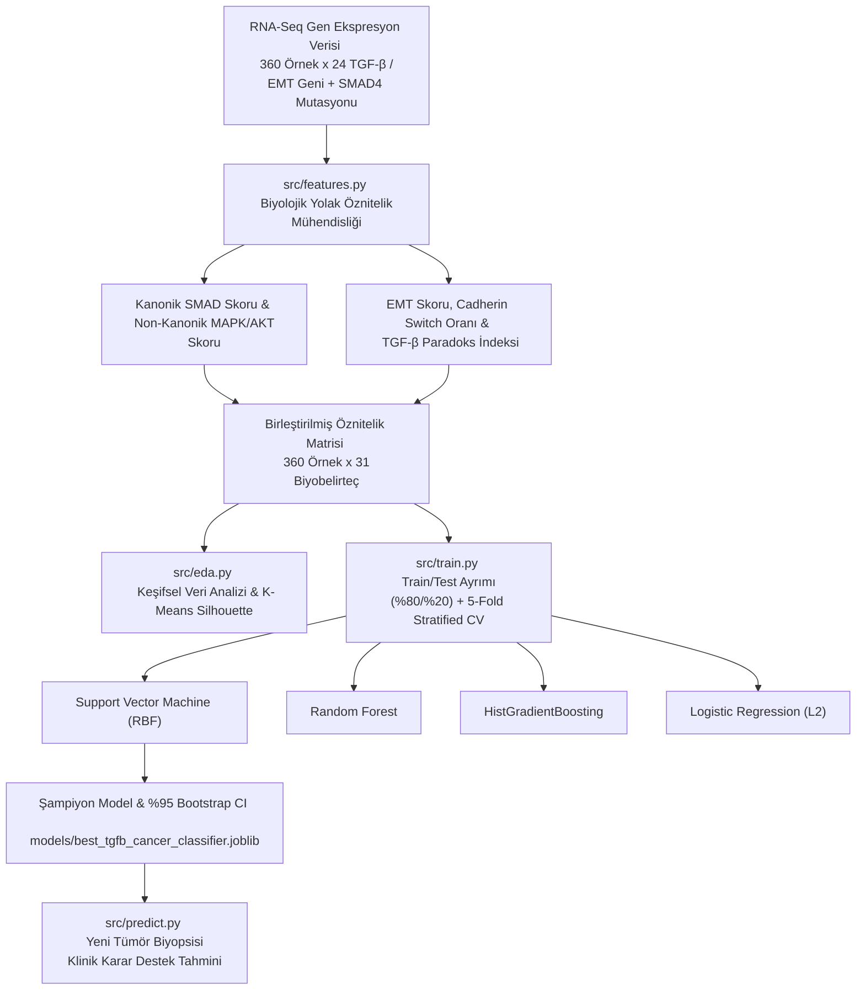

# 🧬🎗️ TGF-β Sinyal Yolağı Paradoksu, EMT ve Kanser Metastaz Sınıflandırması (Midterm Project)

**Ders:** Biyolojide Yapay Zeka (*Artificial Intelligence in Biology - Bio-AI*)  
**Ödev Türü:** Vize Projesi (*Midterm Project*)  
**Alan:** Kanser Sistem Biyolojisi, Sinyal İletim Yolakları (*Signaling Pathways*), Transkriptomik & Makine Öğrenmesi  
**Programlama Dili:** Python 3  
**Ana Çalıştırıcı Betik:** `code-of-midterm.py`  

---

## 📌 1. Biyolojik Arka Plan & Problem Tanımı: "TGF-β Paradoksu"

**Dönüştürücü Büyüme Faktörü-Beta (*Transforming Growth Factor-Beta, TGF-β*)** sinyal yolağı; hücre çoğalması, farklılaşması, apoptoz ve doku homeostazisini düzenleyen en kritik sinyal ağlarından biridir. Kanser biyolojisinde TGF-β yolağı, hastalığın evresine göre tamamen zıt iki rol üstlenir. Literatürde bu iki yüzlü davranış **"TGF-β Paradoksu" (*The TGF-β Paradox*)** olarak adlandırılır:

### A. Erken Evrede Tümör Baskılayıcı Rol (*Tumor Suppressor Phase*)
Sağlıklı epitel hücrelerinde ve erken evre tümörlerde:
- **Kanonik Sinyal İletimi:** *TGFB1/TGFB2* ligandları, hücre zarındaki **TGFBR2** ve **TGFBR1** serin/treonin kinaz reseptörlerine bağlanır.
- Aktif reseptör kompleksi, sitoplazmik **SMAD2** ve **SMAD3** proteinlerini fosforile eder (*R-SMAD*). Fosforile olan *SMAD2/3*, ortak mediyatör **SMAD4** (*Co-SMAD*) ile birleşerek çekirdeğe geçer.
- **Hücre Döngüsü Freni & Apoptoz:** Çekirdekteki *SMAD2/3/4* kompleksi; siklin bağımlı kinaz inhibitörleri olan **CDKN1A ($p21^{Cip1}$)** ve **CDKN2B ($p15^{Ink4b}$)** genlerini aktive ederek hücreyi $G_1$ fazında durdurur, ayrıca pro-apoptotik **BCL2L11 (BIM)** genini uyararak tümörleşmeyi baskılar. Epitel hücreler arası sıkı bağlantılar (**CDH1 / E-Kaderin** ve **OCLN / Oklüdin**) korunur.

### B. İleri Evrede Tümör Tetikleyici Rol & EMT (*Tumor Promoter / Metastatic Phase*)
Tümör ilerledikçe genetik ve epigenetik kırılmalar (*özellikle **SMAD4** delesyonu/mutasyonu ve inhibitör **SMAD7** aşırı ekspresyonu*) kanonik tümör baskılayıcı kolu devre dışı bırakır:
- **Kanonik Olmayan (*Non-Canonical*) Yolakların Hiperaktivasyonu:** Yüksek *TGFB1/TGFB2* sinyali, kanonik olmayan **MAPK1 (ERK)** ve **PI3K/AKT1** sağkalım yolaklarına kanalize olur.
- **Epitel-Mezenkimal Geçiş (EMT) & Cadherin Switch:** Anahtar EMT transkripsiyon faktörleri (**SNAI1 / Snail**, **ZEB1**, **TWIST1**) aşırı eksprese olur. Bunun sonucunda epitel belirteci **CDH1 (E-kaderin)** baskılanırken mezenkimal **CDH2 (N-kaderin)**, **VIM (Vimentin)** ve **FN1 (Fibronektin)** hızla artar (*Cadherin Switch*).
- **İnvazyon ve İmmün Kaçış:** Hücre dışı matriksi parçalayan **MMP2** ve **MMP9** metalloproteinazları ile bağışıklık kontrol noktası **CD274 (PD-L1)** yükselerek uzak organ metastazına yol açar.

---

## 🎯 2. Projenin Amacı ve Yapay Zeka Yaklaşımı

Bu projede, tümör biyopsilerinden elde edilen **24 anahtar TGF-β & EMT geninin RNA-Seq ekspresyon profilleri ($\log_2(\text{TPM}+1)$)** ve **SMAD4 mutasyon durumu** kullanılarak:
1. Biyolojik sinyal yolağı aktivite skorları (**Kanonik SMAD Skoru**, **EMT Transkripsiyon Skoru**, **Cadherin Switch Oranı**, **TGF-β Paradoks İndeksi**) hesaplanmakta,
2. Denetimsiz öğrenme (**PCA Boyut İndirgeme** ve **K-Means Silhouette Kümeleme Analizi**) ile transkriptomik faz uzayı incelenmekte,
3. Denetimli makine öğrenmesi modelleri (**Support Vector Machine - RBF**, **Random Forest**, **HistGradientBoosting**, **Logistic Regression**) ile örnekler **3 biyolojik fenotipe** sınıflandırılmaktadır:
   - `Normal_Epithelial` (*Sağlıklı / Homeostatik Epitel Doku*)
   - `Early_Stage_Tumor_Suppressive` (*Erken Evre — Tümör Baskılayıcı TGF-β Fazı*)
   - `Late_Stage_EMT_Metastatic` (*İleri Evre — TGF-β Paradoksu / EMT & Metastatik Faz*)

---

## ⚙️ 3. Proje Mimarisi ve İş Akışı



---

## 🧬 4. Modellenen Genler ve Biyolojik Yolak İndeksleri

| Fonksiyonel Grup | Gen Sembolleri / Öznitelikler | Biyolojik Rolü |
|---|---|---|
| **TGF-β Ligand & Reseptörleri** | `TGFB1`, `TGFB2`, `TGFBR1`, `TGFBR2` | Sinyal yolağını başlatan sitokinler ve serin/treonin kinaz reseptörleri. |
| **Kanonik SMAD İletimi** | `SMAD2`, `SMAD3`, `SMAD4`, `SMAD7`, `smad4_mutation_status` | Hücre içi kanonik sinyal aktarımı; `SMAD4` kaybı paradoksal geçişin anahtarıdır. |
| **Tümör Baskılayıcı Hedefler** | `CDKN1A` (*p21*), `CDKN2B` (*p15*), `BCL2L11` (*BIM*) | $G_1$ hücre döngüsü durdurulması ve apoptoz indüksiyonu. |
| **Non-Kanonik Kinaz Yolağı** | `MAPK1` (*ERK2*), `AKT1` | İleri evrede sağkalım, çoğalma ve EMT'yi destekleyen yan yolaklar. |
| **Epitel Bütünlük Belirteçleri** | `CDH1` (*E-kaderin*), `OCLN` (*Oklüdin*) | Epitel hücreler arası adherens ve sıkı bağlantı proteinleri. |
| **EMT & Metastaz Efektörleri** | `SNAI1`, `ZEB1`, `TWIST1`, `CDH2`, `VIM`, `FN1`, `MMP2`, `MMP9`, `CD274` | Epitel-mezenkimal geçiş, bazal membran yıkımı ve immün kaçış (*PD-L1*). |
| **Türetilmiş Yolak İndeksleri** | `Canonical_SMAD_Score`, `NonCanonical_Kinase_Score`, `EMT_Transcription_Score`, `Cadherin_Switch_Ratio`, `Mesenchymal_Invasion_Score`, `TGFB_Paradox_Index` | Ham gen ekspresyonlarından hesaplanan sistem biyolojisi aktivite skorları. |

---

## 📈 5. Üretilen Bilimsel Grafikler (`reports/figures/`)

`python code-of-midterm.py` çalıştırıldığında `reports/figures/` klasöründe otomatik olarak **8 adet yüksek çözünürlüklü (220 DPI) grafik** üretilir:

1. **`pathway_expression_heatmap.png`**: 24 TGF-β ve EMT geninin kanser evrelerine göre standartlaştırılmış (Z-skoru) ekspresyon ısı haritası.
2. **`tgfb_paradox_violin.png`**: Evrelere göre *CDKN1A (p21)*, *SMAD4*, *CDH1 (E-kaderin)* ve *VIM (Vimentin)* dağılım keman grafikleri.
3. **`cadherin_switch_paradox.png`**: TGF-β Paradoksu (*Kanonik SMAD Skoru vs. Mezenkimal İnvazyon Skoru*) ve *Cadherin Switch* (*CDH1 vs. CDH2*) saçılım grafikleri.
4. **`pca_pathway_clusters.png`**: 2 boyutlu Temel Bileşenler Analizi (PCA) uzayında tümör evrelerinin ayrışması ve denetimsiz K-Means Silhouette skoru optimizasyonu.
5. **`correlation_network_heatmap.png`**: Epitel koruyucu genler ile EMT/metastaz genleri arasındaki güçlü negatif korelasyonu gösteren Pearson korelasyon matrisi.
6. **`confusion_matrix.png`**: Bağımsız test kümesi (%20) üzerindeki tahminlerin karmaşıklık matrisi.
7. **`model_comparison.png`**: 4 farklı makine öğrenmesi modelinin *5-Fold CV Macro F1*, *Test Accuracy*, *Test Macro F1* ve *ROC-AUC* karşılaştırması.
8. **`feature_importance.png`**: TGF-β paradoksunu ve metastatik geçişi ayırt etmede en yüksek bilgi kazancına sahip ilk 15 biyobelirteç.

---

## 📂 6. Klasör Yapısı

```text
TGFB_Kanser_Vize_Projesi/
├── code-of-midterm.py                   # Tüm pipeline'ı baştan sona yürüten ana betik
├── README.md                            # Proje raporu ve bilimsel dokümantasyon
├── requirements.txt                     # Python bağımlılıkları
├── data/
│   └── tgfb_cancer_expression_data.csv  # 360 örnek x 27 sütunluk RNA-Seq veri seti
├── models/
│   └── best_tgfb_cancer_classifier.joblib # Eğitilmiş en iyi ML pipeline modeli
├── reports/
│   ├── metrics.json                     # Çapraz doğrulama, test ve %95 CI metrikleri
│   └── figures/                         # 8 adet bilimsel grafik (.png)
└── src/
    ├── __init__.py
    ├── generate_dataset.py              # Biyolojik veri seti simülasyonu
    ├── features.py                      # Yolak skorları ve öznitelik mühendisliği
    ├── eda.py                           # Keşifsel veri analizi, PCA ve K-Means
    ├── train.py                         # Sızıntısız (leakage-free) ML eğitimi ve değerlendirme
    └── predict.py                       # Klinik karar destek tahmin aracı (CLI)
```

---

## 🚀 7. Kurulum ve Çalıştırma Rehberi

### 1. Sanal Ortam Oluşturma ve Kütüphaneleri Yükleme
```bash
python -m venv .venv
# Windows PowerShell:
.venv\Scripts\pip install -r requirements.txt
```

### 2. Tüm Vize Projesini Tek Komutla Çalıştırma
```bash
.venv\Scripts\python code-of-midterm.py
```

### 3. Tekil Bir Hasta / Tümör Örneği Üzerinde Tahmin Yürütme
```bash
.venv\Scripts\python src/predict.py --index 25
```

